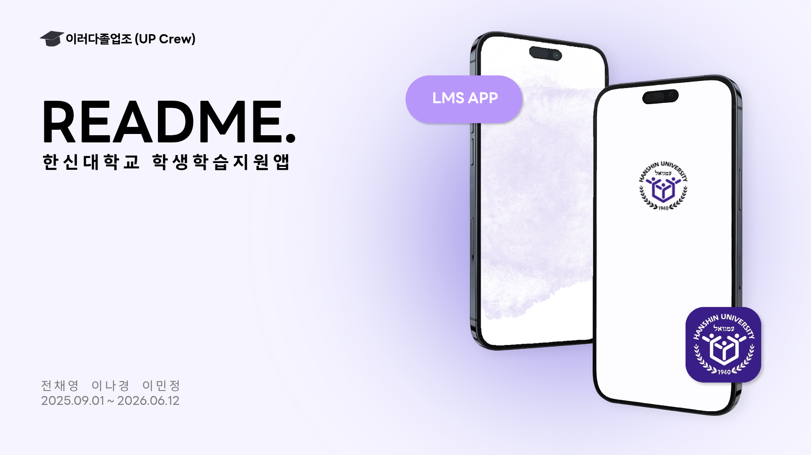
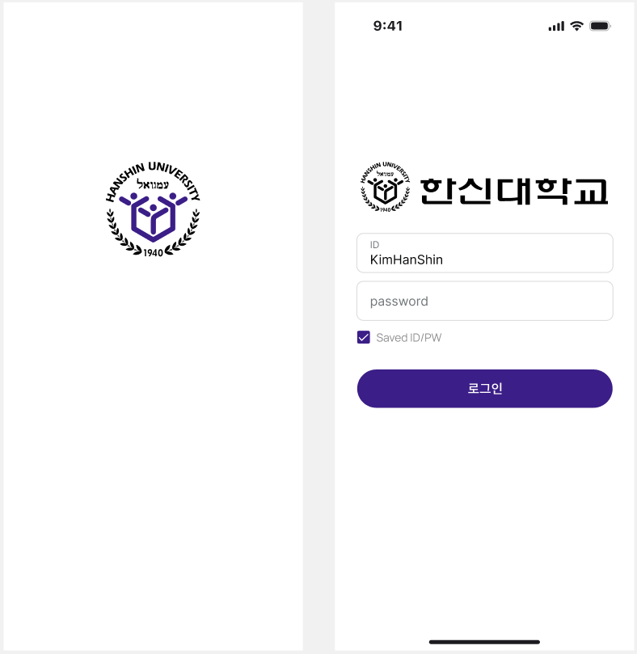
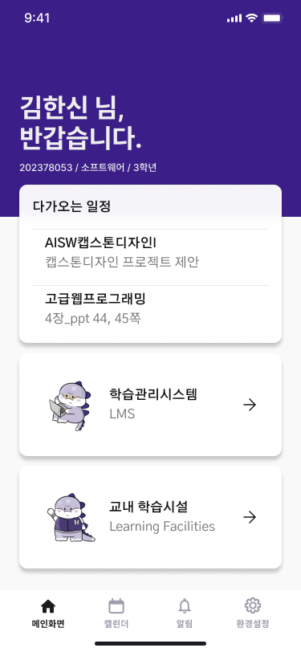
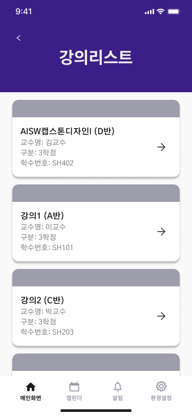
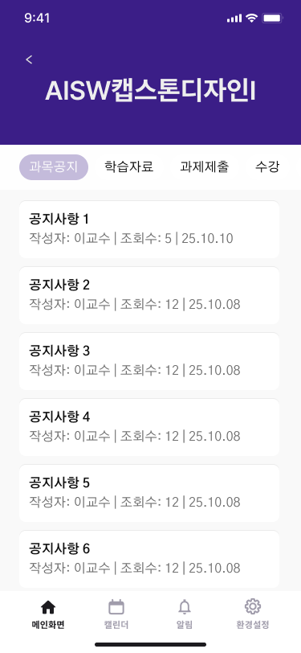
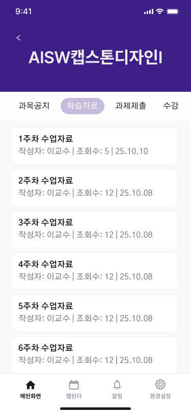
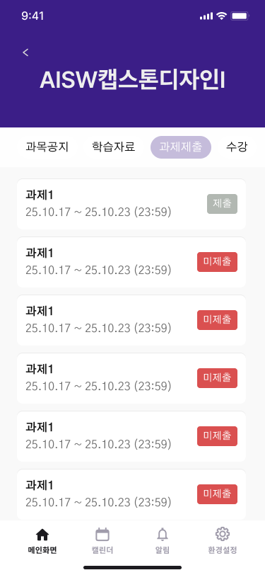
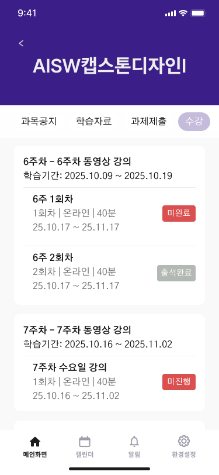

# 📝 한신대학교 학생학습지원앱 — UpCrew


<br>

## 1. 프로젝트 개요
한신대학교 학생학습지원앱은 하나의 통합 플랫폼에서 학습시설 혼잡도 확인, 예약 및 Learning Management System(LMS) 기능을 제공하는 모바일 애플리케이션이다.

<br>

## 1-1. 핵심 기능

### [시작/로그인] 애플리케이션 진입
  - 시작 화면: 애플리케이션 실행 시 표기되는 화면
  - 로그인 화면: 한신대학교 통합로그인 정보로만 로그인 가능
  - 'Saved ID/PW' 기능으로 로그인 정보 유지, 저장된 계정이 있으면 로그인 화면 생략

### [메인] 홈 화면
  - 학적(학번/학과/학년) 표기
  - '다가오는 일정' 최근접 2개 일정 미리보기
  - 학습관리시스템(LMS), 교내 학습시설 페이지로 이동

### [학습시설] 혼잡도 확인
  - OpenCV를 활용해 학습 시설 내 인원 현황을 파악
  - 혼잡도 상태를 "여유/보통/혼잡" 3단계로 표시
  - 건물(관)·층 단위로 꼼지락, 라운지 등 세부 공간의 실시간 이용현황 확인 가능

### [학습시설] 좌석/공간 예약 시스템
  - 회의실, 열람실 등 예약이 필요한 공간에 대해 예약하기/내역 확인 가능
  - 예약 시 해당 공간은 자동으로 '사용 중' 상태로 전환

### [LMS] 강의 및 학습 관리
  - 현재 학기 수강 강의 목록 표기 (강의명, 분반, 담당교수명, 학점, 학수번호)
  - 강의실 진입 시 과목공지 / 학습자료 / 과제제출 / 수강 4개 탭으로 구성
    - 과목공지: 게시된 공지 목록 확인 (작성자, 조회수, 작성일)
    - 학습자료: 주차별 수업자료 목록 확인
    - 과제제출: 과제 목록 및 제출 여부 확인
    - 수강: 주차별 온라인 강의 목록, 학습기간, 수강(출석) 여부 확인

### [LMS] 일정 관리 및 푸시 알림
  - 개인 일정 관리를 위한 캘린더 기능 제공
  - 공지/과제/온라인 강의 등록 시 푸시 알림
  - 과제/온라인 강의 기한 마감 3일, 1일 전 푸시 알림

### [보안] 사용자 인증 및 권한 관리
  - 한신대학교 통합로그인 정보에 기반한 회원가입 및 로그인 기능 제공
  - 학생/교수 구분에 따른 접근 권한 설정

<br>

## 1-2. 채택 개발 기술
- **모바일**: Android (Java), Android Studio
- **백엔드/인프라**: Firebase (Authentication, Firestore, Cloud Functions, Cloud Storage)
- **AI/혼잡도 분석**: Python, OpenCV
- **관리자 웹**: HTML/CSS/JavaScript
- **디자인**: Figma

<br>

## 2. 팀명 및 팀 구성
### 팀명
* 9조 - 이러다졸업조 (UPCrew)

### 팀 구성
* 전채영 (팀장. AISW계열 소프트웨어)
* 이나경 (팀원. AISW계열 소프트웨어/인공지능)
* 이민정 (팀원. AISW계열 데이터사이언스/소프트웨어)

<br>

## 2-1. 역할 분담
### 전채영
* **(주) DB** — 작성 예정
* 모바일 프로그래밍 (Android Studio) — 작성 예정

### 이나경
* **(주) AI** — 작성 예정
* 모바일 프로그래밍 (Android Studio) — 작성 예정

### 이민정
* **(주) UI/UX** — 작성 예정

<br>

## 3. 개발 환경
* **Front-end**: Android (Java), Android Studio
* **Back-end**: Firebase (Firestore, Cloud Functions, Cloud Storage)
* **UI/UX Design**: Figma
* **Collaboration Tools**: Discord, KakaoTalk, GitHub, Figma

<br>

## 4. 폴더 구조
```
capstone25-upcrew/
├── admin-web/      # 관리자 웹 (HTML/CSS/JS)
├── ai/             # 혼잡도 분석 워커 (Python, OpenCV)
├── docs/           # 보고서, 발표자료, README용 이미지
├── frontend/       # Android 앱 (Android Studio)
├── spacesense/     # Android 앱 (Android Studio)
├── functions/      # Firebase Cloud Functions (푸시 알림 등)
├── firebase.json / firestore.rules / firestore.indexes.json / storage.rules
└── .firebaserc
```

<br>

## 5. 실행 방법
### Android 앱 (`frontend/`, `spacesense/`)
```bash
cd frontend   # 또는 cd spacesense
./gradlew assembleDebug
```
Android Studio에서 해당 폴더를 프로젝트로 열어 실행할 수도 있다.

### Firebase Cloud Functions (`functions/`)
```bash
cd functions
npm install
firebase deploy --only functions
```

### 혼잡도 분석 워커 (`ai/`)
```bash
cd ai
pip install -r requirements.txt
python analyzer_worker.py
```

### 관리자 웹 (`admin-web/`)
`admin-web/index.html`을 브라우저로 열어 확인한다.

<br>

## UI/UX
FIGMA 작업 페이지: [캡스톤디자인_이러다졸업(UPCrew)_FIGMA](https://www.figma.com/design/Z9tQCgVkBRwPdPOc9ZHZh1/%EC%BA%A1%EB%94%94_%EC%9D%B4%EB%9F%AC%EB%8B%A4%EC%A1%B8%EC%97%85?node-id=0-1&t=YM0C7m7QOdhPkOWA-1)

### [시작/로그인 화면]
* **시작 화면**
  - 애플리케이션 실행 시 표기되는 화면
* **로그인 화면**
  - 시작 화면 직후 표기되는 화면
  - 한신대학교 통합로그인 정보로만 로그인 가능
  - 저장된 로그인 계정이 있는 경우 생략

| 시작 화면(좌) / 로그인 화면(우) |
|----------|
|  |

### [메인 화면]
* **메인 화면**
  - 로그인 후 진입하는 첫 번째 화면
  - 하단의 '메인화면' 버튼으로 바로가기 기능 지원
* **상세**
  - [상단] 학적 확인
  - [다가오는 일정] 기한이 가장 임박한 2개 일정 미리보기
  - [학습관리시스템] LMS 페이지로 이동
  - [교내 학습시설] 학습시설 현황 및 예약 페이지로 이동

| 메인 화면 |
|----------|
|  |

### [학습시설 화면]
* **학습시설 화면**
  - 메인 화면에서 '교내 학습시설' 카드를 눌러 진입하는 화면
  - 한신대학교 학습 시설을 관(건물), 층 단위로 표기
* **상세**
  - 학습시설이 존재하는 관, 층 표기
  - 혼잡도(혼잡/보통/여유) 상태 표기
  - 회의실, 열람실 예약하기 / 예약 내역 확인 기능

### [LMS: 강의리스트 화면]
* **강의리스트 화면**
  - 메인 화면에서 LMS 버튼을 눌러 진입하는 화면
  - 현재 학기의 수강 강의 목록 표기
* **상세**
  - [상단] 페이지 확인
  - [중단 스크롤] 수강 강의 목록 확인
  - [강의 카드] 강의명, 분반, 담당교수명, 구분(학점), 학수번호 표기

| 강의목록 화면 |
|----------|
|  |

### [LMS: 강의실 화면]
* **강의실 화면**
  - 강의리스트에서 특정 강의를 선택하여 진입하는 화면
  - 진입 시 과목공지 페이지 표기
  - 좌우 방향 스크롤을 통한 페이지 이동
* **과목공지 화면**
  - [상단] 강의실 확인
  - [중단 스크롤] 게시된 공지 목록 확인
* **학습자료 화면**
  - [상단] 강의실 확인
  - [중단 스크롤] 게시된 학습자료 목록 확인
* **과제제출 화면**
  - [상단] 강의실 확인
  - [중단 스크롤] 게시된 과제 목록 확인
  - [과제 카드] 제출 여부를 직관적으로 표기
* **수강 화면**
  - [상단] 강의실 확인
  - [중단 스크롤] 게시된 온라인 강의 목록 확인
  - [수강 카드] 주차, 주차 기준 학습기간, 회차 정보, 수강 여부 등 표기

| 과목공지 화면 | 학습자료 화면 | 과제제출 화면 | 수강 화면 |
|------|------|------|------|
|  |  |  |  |
